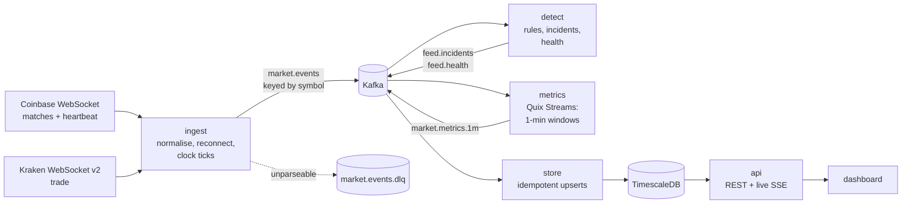

# FeedWatch

[](https://github.com/smymuna/feedwatch/actions/workflows/ci.yml)


[](https://smymuna.github.io/feedwatch/)


**Real-time data quality monitoring for live market data feeds.**

Every fintech app, broker and price website consumes live price feeds from exchanges, and
those feeds fail quietly: a connection stalls and the app keeps showing an old price,
trades go missing during a reconnect, one exchange prints a price far from everyone else,
or a "stable" coin slips off its $1 peg. FeedWatch streams trades from **Coinbase** and
**Kraken** through **Kafka**, checks them continuously, and raises an incident within
seconds when the data can't be trusted.

**Live demo: https://smymuna.github.io/feedwatch/** (browser edition: your browser connects
straight to Coinbase and Kraken and runs the same detection rules in the page; open
[the USDC 2023 replay](https://smymuna.github.io/feedwatch/#/replay) to watch it catch a real
depeg). The full pipeline below runs locally with `make up`.

> **It does not trade, place orders or give financial advice.** It only reads public
> market data that exchanges broadcast to everyone, and judges its quality.

## Proven on a real incident: the USDC depeg of March 2023

When Silicon Valley Bank failed, the USDC stablecoin lost its peg for a weekend. Kraken
keeps its full public trade history, so FeedWatch can replay all **269,430 USDC trades**
from 10 to 13 March 2023 through the same detector that runs live:

```console
$ make usdc
2023-03-10 22:02:44  !  OPEN     depeg   USDC trading at $0.9950 (-0.50 %) on kraken
2023-03-10 23:48:11  !  RESOLVED depeg   USDC back within 0.3 % of $1.
2023-03-11 00:35:35  !  OPEN     depeg   USDC trading at $0.9949 (-0.51 %) on kraken
2023-03-11 03:14:01  !! OPEN     depeg   USDC trading at $0.9792 (-2.08 %) on kraken
...
2023-03-12 22:26:09  !  OPEN     depeg   USDC trading at $0.9857 (-1.43 %) on kraken
2023-03-13 13:53:24  !  RESOLVED depeg   USDC back within 0.3 % of $1.

2 incident(s), 0 still open at the end
```

| UTC | FeedWatch | What happened |
|---|---|---|
| Fri 10 Mar, 22:02 | Early warning, −0.5 % | Markets react to SVB's failure that day; USDC's exposure is suspected but not yet confirmed |
| Sat 11 Mar, 03:14 | **Critical**, −2 % and worse (low: $0.879 one-minute average) | 5 minutes after Circle confirms $3.3B of USDC's reserves are at SVB (about 03:09 UTC); lowest single trade $0.874 at 07:15 |
| Sun 12 Mar, 22:26 | Steps down to warning | US authorities announce the SVB backstop (about 22:15 UTC) |
| Mon 13 Mar, 13:53 | Resolved | USDC back within 0.3 % of $1 |

This replay is a **regression test** (`tests/unit/test_usdc_2023.py`): any change to the
rules must still produce exactly these two incidents.

## What it detects

| Incident | Means | How |
|---|---|---|
| **Feed silent** | No messages from an exchange | Nothing for 10 s, judged by a once-a-second clock so it fires even when everything is quiet |
| **Missing trades** | Trades lost, e.g. during a reconnect | Trade ids are consecutive per coin; Coinbase heartbeats also report the latest id, so even a silent loss is caught, with the exact count |
| **Price divergence** | The exchanges disagree on a price | Both traded in the last 20 s and differ by more than 50 bps (30 bps for stablecoins) for 10 s |
| **Depeg** | A stablecoin is off $1 | One-minute volume-weighted price at least 0.5 % (warning) or 2 % (critical) away, on every exchange with data |
| **Bad print** | A trade far from the market that the market ignored | Far from the recent median *and* the next trades snap back; real moves are not flagged |
| **High latency** | Data arriving late | 95th percentile of exchange-to-us delay above 3 s over a minute |

Every threshold, and why it's set where it is: [docs/detection-rules.md](docs/detection-rules.md).

## The dashboard

- **Overview:** feed health per exchange, a stablecoin peg board, whether the exchanges
  agree on each price, the incident timeline, and a card per coin with its live price and
  the last hour as a sparkline.
- **Coin pages** (click any coin, e.g. `#/coin/BTC-USD`):
  - live one-minute **candles** (TradingView lightweight-charts), the newest candle
    building trade by trade;
  - a switch between Coinbase and Kraken, with the other exchange drawn as a dashed line,
    so a disagreement is visible at a glance;
  - **incident markers** on the chart where something went wrong;
  - each exchange's live price (and distance from $1 for stablecoins), every trade as it
    happens, per-exchange stats, and the coin's incident history.

Finished minutes come from TimescaleDB. The current minute and the trade list come from
the API following Kafka directly, pushed to the browser twice a second over Server-Sent
Events.

## Architecture



Five small services, one Docker image. The design decisions and their trade-offs are in
[docs/architecture.md](docs/architecture.md) and [docs/adr/](docs/adr/).

## Run it

You need Docker. Everything else runs in containers.

```bash
make up        # live: both exchanges → Kafka → dashboard on http://localhost:8000
make demo      # a fresh stack replaying a recorded session with six faults injected
make usdc      # replay the March 2023 USDC depeg in your terminal (needs `make install`)
```

`make demo` is the quickest way to see incidents: within a few minutes the dashboard shows
a bad print, 51 missing BTC trades, a 118 bps ETH divergence, a confirmed USDT depeg and a
Kraken outage, each opening and then resolving.

For development without Docker:

```bash
make install   # .venv + dashboard packages
make check     # ruff, mypy --strict, 60 unit tests, dashboard tests
docker compose up -d kafka db && make integration   # end-to-end through Kafka and PostgreSQL
```

Useful commands (`feedwatch --help` for all):

```bash
feedwatch backtest samples/session --scenario scenarios/kraken-outage.json
feedwatch replay samples/session --scenario scenarios/drill.json --speed 3
feedwatch history USDTUSD 2026-10-01T00:00 2026-10-02T00:00   # download any Kraken history
feedwatch ingest --record                                      # keep raw messages for replay
```

The API has interactive docs at http://localhost:8000/docs.

## What's in the repository

```
src/feedwatch/
  sources/      Coinbase and Kraken parsers (pure, tested on captured real messages)
  ingest/       WebSocket service: reconnects with backoff, clock ticks, dead letters
  detect/       the detection engine (plain Python) and its Kafka service
  metrics/      one-minute windows with Quix Streams
  store/        Kafka → TimescaleDB with idempotent upserts; schema.sql
  api/          FastAPI: REST + Server-Sent Events, a live Kafka view per coin, serves the dashboard
  replay/       recordings, Kraken history download, fault injection
dashboard/      React + TypeScript (Vite): overview and coin pages with live candle charts
scenarios/      fault scenarios: outage, dropped trades, price drift, depeg, latency, bad print
samples/        a 5-minute live recording (10 Oct 2026) and the March 2023 USDC history
tests/          unit tests, the real-data regression test, and an end-to-end Kafka test
docs/           architecture, data sources, detection rules, operations, ADRs
```

## Engineering notes

- **Tests:** 60 unit tests (parsers on real captured messages; every rule with hand-built
  event sequences; fault injection; windowed metrics; the live candle buffer), the March
  2023 regression test, an end-to-end test through real Kafka and PostgreSQL, and
  dashboard tests (formatting, candle merging).
- **Checks:** `ruff`, `mypy --strict`, CI on every push, plus a Docker smoke test that
  replays the USDC depeg inside the built image.
- **Delivery:** at-least-once everywhere, made safe by idempotent writes: incidents are
  upserted by id, metrics by symbol + exchange + minute. A replayed message overwrites the
  same row. ([ADR 0004](docs/adr/0004-at-least-once-with-idempotent-writes.md))
- **Exact numbers:** prices are `Decimal` end to end (Kraken sends JSON numbers, which we
  never let pass through a float).
- **No false alarms on healthy data:** the 5-minute live recording produces zero incidents;
  each scenario then produces exactly the incident it injects.

## Limitations

- **Two exchanges.** With two sources a divergence tells you they disagree, not always which
  one is wrong. For stablecoins the source further from $1 is named as the likely culprit;
  for other coins a third source would settle it.
- **Thin markets.** Some stablecoin pairs (DAI, PYUSD, USDS) trade only a few times an hour,
  so their peg can only be judged when they trade. The dashboard says "no trades yet"
  rather than showing a stale price as healthy.
- **Clock skew.** Latency compares the exchange's clock with ours. A few milliseconds of
  skew is normal and is shown as "<1 ms" rather than a negative number; run NTP.
- **History has no heartbeats.** Replays of trade history check price rules only; silence
  and latency need a live connection.
- **Single-node Kafka** in Docker Compose. A real deployment would run three brokers with
  replication factor 3; the topic layout already allows more partitions and detector
  instances ([docs/architecture.md](docs/architecture.md#scaling)).

## Data and licence

Market data from the public WebSocket and REST APIs of
[Coinbase Exchange](https://docs.cdp.coinbase.com/exchange/websocket-feed/overview) and
[Kraken](https://docs.kraken.com/api/). No account or API key is used.

Code: MIT, see [LICENSE](LICENSE).
