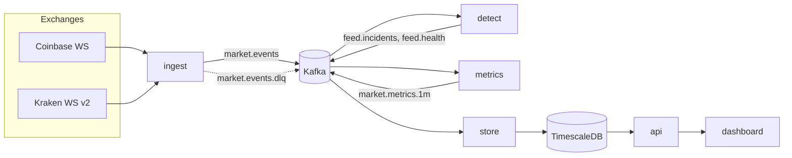

# Architecture

FeedWatch is five small services around Kafka, built from one Python package and one
Docker image (the command picks the service).

| Service | Reads | Writes | State |
|---|---|---|---|
| `ingest` | 2 WebSockets | `market.events`, `market.events.dlq` | none (optionally records raw messages) |
| `detect` | `market.events` | `feed.incidents`, `feed.health` | in memory, rebuilt from the log on start |
| `metrics` | `market.events` | `market.metrics.1m` | RocksDB + Kafka changelog (Quix Streams) |
| `store` | incidents, health, metrics | PostgreSQL / TimescaleDB | the database |
| `api` | PostgreSQL | HTTP: REST + Server-Sent Events, serves the dashboard | none |

## One event stream

Everything the exchanges send becomes one of four event kinds on `market.events`
(`src/feedwatch/models.py`):

| Kind | Example | Why it exists |
|---|---|---|
| `trade` | Coinbase match, Kraken trade | the data itself, normalised to one format |
| `heartbeat` | Coinbase per-product heartbeat with `last_trade_id`; Kraken per-connection | proves the connection is alive; Coinbase's reveals trades we never received |
| `connection` | connected / subscribed / disconnected / error | separates "the exchange is quiet" from "we lost the connection" |
| `tick` | once a second from `ingest` | moves processing time forward so time-based rules fire even when every exchange is silent |

Prices and sizes are decimals in memory and strings in JSON. Normalisation details per
exchange are in [data-sources.md](data-sources.md).

## Topics

| Topic | Key | Partitions | Retention | Why |
|---|---|---|---|---|
| `market.events` | symbol (e.g. `BTC-USD`) | 3 | 3 days | one symbol's data from **every** exchange lands in one partition, in order, so comparing exchanges never needs a cross-partition join; 3 days lets services rebuild state |
| `market.events.dlq` | source | 1 | 7 days | messages that could not be parsed, with the error, for inspection |
| `feed.incidents` | incident id | 1 | compacted | the latest version of every incident, forever |
| `feed.health` | `health` | 1 | 1 hour | live snapshots; only the newest matters |
| `market.metrics.1m` | `source|symbol` | 1 | 30 days | minute bars |

Events that are not about a symbol (ticks, connection changes, Kraken's per-connection
heartbeats) are written to **every** partition, so each detector instance sees time pass
and sources come and go (`JsonProducer.send_event`).

## Time

The detector uses two clocks on purpose ([ADR 0002](adr/0002-event-time-and-processing-time.md)):

- **Event time** (the exchange's timestamp) for anything about prices: divergence, depegs,
  bad prints, and the metrics windows.
- **Processing time** (when we received it) for anything about the feed: silence and
  latency.

The metrics job closes each one-minute window 5 seconds after it ends (grace period), so a
trade that arrives slightly late still lands in the right minute.

## Delivery guarantees

At-least-once end to end, with idempotent writes ([ADR 0004](adr/0004-at-least-once-with-idempotent-writes.md)):

- `ingest` uses an idempotent producer (`enable.idempotence`, `acks=all`): broker retries
  never duplicate a message.
- `detect` commits offsets only after its outputs are acknowledged by Kafka.
- `store` commits offsets only after the database transaction commits; every write is an
  upsert on a natural key, so a replayed message rewrites the same row.
- The incidents topic is compacted on the incident id, so consumers always end up with the
  latest version of each incident.

## Restarting the detector

Its state covers minutes, not days, so instead of checkpointing it the detector rebuilds it
from the log ([ADR 0003](adr/0003-detector-state-from-the-log.md)): on start it rewinds
each partition 15 minutes before its committed offset and replays that span silently, then
publishes as normal. No incident is lost or duplicated by a restart.

## Scaling

- **More symbols or exchanges:** add partitions to `market.events` and run more `detect`
  instances in the same consumer group. Because events are keyed by symbol, each instance
  owns whole symbols, and broadcast ticks keep every instance's clock moving.
- **More throughput:** the hot path is parsing and the detector's per-trade work (median of
  the last 50 trades, a few dictionary lookups). Replaying the March 2023 USDC history
  (550,205 events) through the detector takes 3.2 s on one laptop core, about 170,000
  events per second; live volume across both exchanges is tens of events per second.
- **Production:** three Kafka brokers with replication factor 3 and `min.insync.replicas=2`,
  managed PostgreSQL, the API behind a load balancer (it is stateless).
